# 🚜 Awesome Autonomous Mining Heavy Fleet Navigators 📡

### Curated Fleet Autonomy Stack: Autonomous Haulage Systems (AHS), Fleet Dispatch, Off-Road Perception & Robotic Excavation

  
  
  
  
  
  

  <strong>The definitive open-source index and enterprise buyer's matrix for autonomous mining machinery, self-driving haul trucks, VDA 5050 fleet dispatch, and open-pit mining robotics.</strong>

---

## 📌 Overview & Scope

Welcome to the definitive index of **Autonomous Mining Heavy Fleet Navigators**. This repository tracks commercial **SaaS platforms** and **open-source robotics frameworks** designed for autonomous surface and underground mining operations. Key technical competencies include:

* 🚛 **Autonomous Haulage Systems (AHS)**: Multi-vehicle trajectory planning, GNSS-denied dead reckoning, LiDAR/radar obstacle bypass, and collision mitigation.
* 🛰️ **Intelligent Fleet Dispatch & Scheduling**: Dynamic haul route optimization, shovel-truck queuing algorithms, discrete-event simulation, and real-time telemetry.
* 🕹️ **Heavy Excavation & Loader Robotics**: Teleoperation cockpits, hydraulic actuator control, VLA (Vision-Language-Action) foundation models, and robotic payload estimation.
* 🔄 **Standardized Interoperability**: Open fleet protocols such as **VDA 5050**, **Open-RMF**, ROS 2 microservices, and sensor-fusion perception pipelines.

---

## 📊 Sector Overview & Market Dynamics

The global autonomous mining equipment and fleet navigation sector is valued at approximately **$4.5B to $5.0B** and projected to surpass **$11B to $15B+** by the early 2030s (CAGR of ~11%). The market exhibits a **bifurcated concentration**: the physical heavy-machinery and ultra-class vehicle layer is **highly concentrated** among global legacy OEMs (Caterpillar, Komatsu, Sandvik, Epiroc), whereas the autonomy perception software, retrofit navigation kits, and interoperable fleet dispatch layer is **moderately fragmented**, driving consolidation and venture-backed innovation.

---

## 📑 Table of Contents

- [📊 Sector Overview & Market Dynamics](#-sector-overview--market-dynamics)
- [🏢 SaaS & Commercial Enterprise Platforms](#-saas--commercial-enterprise-platforms)
- [💻 Open-Source GitHub Projects](#-open-source-github-projects)
- [🛠️ Building a Custom Autonomous Fleet Stack](#️-building-a-custom-autonomous-fleet-stack)
- [🤝 How to Contribute](#-how-to-contribute)
- [⭐ Star History](#-star-history)
- [💖 Support & Sponsorship](#-support--sponsorship)
- [⚠️ Disclaimer](#️-disclaimer)

---

## 🏢 SaaS & Commercial Enterprise Platforms

| Platform | Company Scale (Revenue / Valuation) | Pricing (Starting Tier) | Free Tier Limits / Evaluation | Overview & Focus |
| :--- | :--- | :--- | :--- | :--- |
| **[Caterpillar MineStar](https://www.cat.com/en_US/by-industry/mining/surface-mining/surface-technology.html)** | $67.6B annual revenue (Caterpillar Inc.) | Starting at ~$15,000/site/year (entry-level MineStar Edge fleet tracking; scales up for Command AHS) | No permanent free tier; 30-day dealer-facilitated on-site pilot trial kits available upon qualification | Flagship mining ecosystem with Command (haulage), Fleet (dispatch), and Health (diagnostics) managing the world's largest autonomous truck fleet. |
| **[Komatsu FrontRunner](https://www.komatsu.com/en/solutions/mining/autonomous-haulage/)** | ~$26.5B (¥4.13T) annual revenue (Komatsu Ltd.) | Starting at ~$50,000/site base deployment license (scales with fleet size & network dispatch) | No permanent free tier; 30-to-60 day controlled site proof-of-concept (PoC) trial on select mine testbeds | Autonomous haulage system (AHS) with extensive open-pit deployments globally, featuring high-precision GNSS and obstacle avoidance. |
| **[Sandvik AutoMine](https://www.rocktechnology.sandvik/en/products/automation/automine/)** | ~$12.8B (SEK 120.7B) annual revenue (Sandvik AB) | Starting at ~$25,000 baseline software deployment (AutoMine Lite / Tele-Remote entry tier) | No permanent free tier; 30-day simulation & hardware testbed pilot evaluation for certified mine operators | Underground loaders and trucks automation suite enabling autonomous navigation and remote control from surface operations rooms. |
| **[Epiroc Mobius](https://www.epiroc.com/en-us/products/automation/mobius)** | ~$5.8B (SEK 60B+) annual revenue (Epiroc AB) | Starting at ~$20,000/year base server platform license (Mobius Core dispatch & fleet tracking) | No permanent free tier; 30-day interactive simulation environment sandbox demo upon enterprise verification | Mixed-fleet automation and traffic management platform for underground and surface drilling and haulage operations. |
| **[Hexagon Mining](https://hexagon.com/industries/mining)** | ~$4.0B (€3.7B) annual revenue (Hexagon AB) | Starting at ~$12,000/year (entry MinePlan & OP Pro fleet management single-seat module) | No permanent free tier; 14-day full-feature trial for select planning software modules | Comprehensive digital mining platform combining autonomous drilling, fleet dispatch, collision avoidance, and spatial analytics. |
| **[Pronto](https://pronto.ai/)** | ~$1.7B parent valuation (Acquired by Atoms, $1.7B Series A) | Starting at ~$5,000/vehicle/month (Autonomous Haulage System retrofit subscription) | No permanent free tier; 14-day field demonstration & pilot benchmark period on active quarry haul routes | Sensor-driven retrofit autonomy suite for production haulage in quarry and mining fleets, eliminating reliance on extensive fixed infrastructure. |
| **[RPMGlobal](https://www.rpmglobal.com/)** | $681M acquisition valuation (Acquired by Caterpillar; ~$50M+ ARR) | Starting at ~$10,000/year per workstation/module license (AMT Asset Management / Schedule modules) | No permanent free tier; 30-day guided enterprise evaluation license (educational partners get free semester lab licenses) | Mining software enterprise suite delivering short- and long-term mine planning, fleet simulation, and maintenance scheduling. |
| **[ASI Mining](https://www.asimining.com/)** | ~$225M parent funding (SoftBank) / ~$30M pre-acquisition revenue | Starting at ~$8,000/vehicle/month base autonomy kit & Mobius-integrated software license | No permanent free tier; 30-day structured proof-of-concept site simulation trial for commercial fleet operators | OEM-agnostic autonomous conversion kits (Mobius Core) for retrofitting haul trucks, excavators, and ancillary vehicles. |
| **[SafeAI](https://safeai.com/)** | ~$150M historical valuation ($91M funding; merged with Pronto) | Starting at ~$6,500/vehicle/month autonomy software subscription tier | No permanent free tier; 30-day monitored site demonstration and deployment trial on partner machinery | Heavy equipment retrofit autonomy platform automating mixed hauling and loading fleets for open-pit mining and construction. |
| **[Teleo](https://teleo.ai/)** | ~$60M valuation ($29.8M venture funding) | Starting at ~$3,500/month per operator station / vehicle kit subscription | No permanent free tier; 14-day on-site equipment teleoperation pilot trial for qualified construction & mining contractors | Supervised autonomy and high-precision remote operation system allowing centralized control of excavators and wheel loaders. |

## 💻 Open-Source GitHub Projects

Curated open-source frameworks for mine fleet dispatch algorithms, off-road autonomy stacks, heavy machinery robotics, and multi-agent coordination. Sorted in **descending order by GitHub_Stars**.

| Project | GitHub_Stars | Focus & Specialization | Highlights & Stack |
| :--- | :--- | :--- | :--- |
| **[CARLA Simulator](https://github.com/carla-simulator/carla)** |  | Open-source simulator for autonomous driving research | Unreal Engine-based photorealistic environment with customizable off-road, quarry, and sensor suite simulations (LiDAR, Radar, GNSS, RGB/depth cameras). Widely used for stress-testing heavy equipment autonomy. |
| **[Autoware](https://github.com/autowarefoundation/autoware)** |  | Open-source autonomous driving stack (ROS 2) | Full-stack autonomy architecture (sensing, localization, perception, planning, and control) adaptable to autonomous haulage trucks and surface mining utility vehicles. |
| **[Nav2 (Navigation 2)](https://github.com/ros-navigation/navigation2)** |  | ROS 2 State-of-the-Art Navigation Framework | Robust path planning, behavioral tree coordination, dynamic costmaps, and obstacle avoidance suitable for heavy AGVs and open-pit mobile robotic machinery. |
| **[openTCS](https://github.com/openTCS/openTCS)** |  | Transportation Control System for Automated Fleets | Enterprise-grade, vendor-independent fleet dispatch platform with native **VDA 5050** support, collision-free route planning, order dispatching, and dynamic traffic routing. |
| **[Open-RMF](https://github.com/open-rmf/rmf)** |  | Open Robotics Middleware Framework | Standardized multi-fleet traffic deconfliction and coordination engine for heterogeneous fleets (loaders, haulers, autonomous haulage trucks) across shared infrastructure. |
| **[Transact Dashboard](https://github.com/transitiverobotics/transact)** |  | Robot Fleet Management Dashboard | Modern open-source monitoring dashboard and operational telemetry platform for remote mobile robot fleets, video feeds, and mission control. |
| **[EZ-RASSOR](https://github.com/FlaSpaceInst/EZ-RASSOR)** |  | Autonomous Regolith Mining & Excavation Robot | Open-hardware and ROS-controlled autonomous digging/drum excavation robot designed for extreme surface conditions, obstacle navigation, and autonomous dumping cycles. |
| **[OpenMines](https://github.com/370025263/openmines)** |  | Comprehensive Open-Pit Mine Truck Dispatching Simulator | The foundational Python-based benchmark for open-pit mine fleet algorithm development. Includes 6 baseline dispatchers (Nearest, FixedGroup, SPTF, SQ), random event simulation, and real-mine production curve visualization. |
| **[NATURE Stack](https://github.com/CGoodin/nature-stack)** |  | Off-Road Autonomous Navigation Software Stack | Navigating All Terrains Using Robotic Exploration (MSU CAVS / US Army ERDC). Features terrain slope cost mapping, off-road path planners (spline, artificial potential field), and vehicle dynamics control. |
| **[OpenRobOps](https://github.com/OpenRobOps/oro)** |  | Open-Source Robot Fleet Operations Platform | Cloud-native fleet management system offering real-time heartbeat monitoring, deployment management, and remote diagnostic logs for industrial robotic machinery. |
| **[Autonomous Excavator (MathWorks)](https://github.com/mathworks-robotics/autonomous-excavator)** |  | Heavy Off-Road Vehicle Virtual Testbench | MATLAB/Simulink/Simscape multibody model with Unreal Engine co-simulation for autonomous excavator arm trajectory planning, LiDAR point-cloud processing, and hydraulic control. |
| **[ROS 2 TMS for Construction](https://github.com/irvs/ros2_tms_for_construction)** |  | Task Management System for Heavy Construction Machinery | OPERA platform-compliant task coordination architecture evaluated on full-scale automated hydraulic excavators and teleoperated machinery. |
| **[Mining-Gym](https://github.com/CBCodeHub/Mining-Gym)** |  | RL Benchmarking Environment for Mine Dispatch | Salabim-powered discrete-event simulation with Gymnasium API wrappers. Features 4 classical schedulers (SQF, min-wait) and 5 deep reinforcement learning algorithms (Maskable PPO, DQN, TRPO). |
| **[Wheel Loader Robot](https://github.com/WfHit/wheel_loader_robot)** |  | PX4-Based Heavy Wheel Loader Autonomy | Autonomous boom/bucket control system supporting 50Hz trajectory execution, VLA (Vision-Language-Action) remote auto mode, and autonomous load/pickup/placement cycles. |
| **[JKCOM](https://github.com/olivestackscode/jkcom)** |  | AI Sensor Fusion & High-Precision Localization Stack | Multi-sensor fusion engine (Camera + Radar + GPS/IMU) with HD mapping, real-time SLAM, and GNSS-denied dead reckoning adaptable to quarry haul fleets. |

---

## 🛠️ Building a Custom Autonomous Fleet Stack

Engineers and researchers can combine these open-source building blocks into a production-grade, vendor-agnostic heavy fleet platform:

1. **Simulation & Algorithm Benchmarking**: Use **[OpenMines](https://github.com/370025263/openmines)** for discrete-event dispatch validation and **[Mining-Gym](https://github.com/CBCodeHub/Mining-Gym)** to train reinforcement learning policies.
2. **Off-Road Navigation & Perception**: Deploy **[NATURE Stack](https://github.com/CGoodin/nature-stack)** and **[Autoware](https://github.com/autowarefoundation/autoware)** for terrain traversability analysis, LiDAR point-cloud clustering, and slope safety checking.
3. **Multi-Fleet Central Dispatch**: Coordinate heterogeneous machinery using **[openTCS](https://github.com/openTCS/openTCS)** or **[Open-RMF](https://github.com/open-rmf/rmf)** utilizing standard **VDA 5050** message interfaces.
4. **Machinery Actuator Control**: Couple hydraulic bucket/arm kinematics using design patterns from **[MathWorks Autonomous Excavator](https://github.com/mathworks-robotics/autonomous-excavator)** and **[Wheel Loader Robot](https://github.com/WfHit/wheel_loader_robot)**.

---

## 🤝 How to Contribute

Contributions from mining engineers, robotics researchers, and autonomy practitioners are warmly welcomed!

1. 🍴 **Fork the repository**.
2. 🌿 **Create a feature branch** (`git checkout -b feature/add-new-nav-tool`).
3. 📝 **Add or update entries in `README.md`** (ensure SaaS entries include specific pricing tiers, free tier limits, and company scale; ensure open-source repos include social Stars_Badges).
4. 🚀 **Submit a Pull Request** with a concise description of the tool and verified reference links.

---

## ⭐ Star History

---

## 💖 Support & Sponsorship

Thank you for visiting and supporting this open mining robotics initiative! 🌟

If you find this repository valuable for your research, fleet deployment, or technical benchmarking:
* ⭐ **Star this repository** to improve visibility across the robotics and mining engineering community.
* 🍴 **Fork and share** with colleagues working on off-road automation, mine dispatch, or heavy machinery autonomy.
* ☕ **Buy me a coffee & sponsor my open-source work**: Support sustained curation and development via the [GitHub Sponsor Dashboard](https://github.com/sponsors/ishandutta2007).

---

## ⚠️ Disclaimer

* This repository is a **community-curated index** for informational, research, and benchmarking purposes. It does not constitute formal engineering endorsement.
* **Safety Regulations**: Autonomous mining fleet systems controlling heavy haulage machinery must strictly adhere to regulatory mandates (e.g., MSHA in the United States, ISO 17757 for autonomous and semi-autonomous mining systems, and regional equivalents).
* **Simulation-First Autonomy**: OpenMines and Mining-Gym provide simulation testbeds. Real-world machine deployment demands rigorous hardware-in-the-loop (HIL) testing, emergency failsafes, redundant communication links, and certified functional safety interlocks.
* **Harsh Environments**: Off-road mining conditions (severe dust, steep grade variations, GNSS occlusions, extreme temperatures) require industrial-grade hardened compute and validated perception stacks.

---

  Maintained by <a href="https://github.com/ishandutta2007">Ishan Dutta</a> and the global autonomous mining engineering community.

